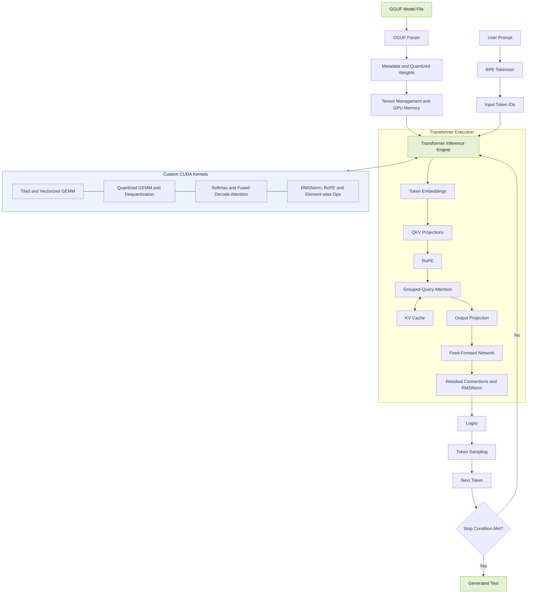

# CRETIF — LLM Inference Engine in C++17/CUDA

**Author:** [Vaishnav Sreekumar](https://github.com/VaishnavSreekumar)  
**Repository:** [VaishnavSreekumar/CRETIF](https://github.com/VaishnavSreekumar/CRETIF)

<p align="center">
  
</p>

CRETIF is a transformer inference engine written in C++17 and CUDA. It loads pretrained models from GGUF files, executes transformer operations through custom CUDA kernels, and generates autoregressive text on consumer GPUs.

The implementation covers binary-format parsing, BPE tokenization, quantized weight loading, grouped-query attention (GQA), KV-cache management, kernel fusion, and end-to-end inference. It also includes a CUDA kernel investigation examining shared-memory bank conflicts and compiler-generated LLVM NVPTX/PTX address calculations.

**Hardware target:** NVIDIA RTX 3060 Laptop GPU (6 GB VRAM, SM 8.6, CUDA 12.8)  
**Test coverage:** 221 tests passing, as reported by the existing project test suite.

---

## Table of Contents

- [Features](#features)
- [CUDA Compiler and PTX Investigation](#cuda-compiler-and-ptx-investigation)
- [Benchmark Results](#benchmark-results)
- [Correctness and Testing](#correctness-and-testing)
- [Requirements](#requirements)
- [Build](#build)
- [Run Inference](#run-inference)
- [Run Tests](#run-tests)
- [Run Benchmarks](#run-benchmarks)
- [Documentation](#documentation)
- [License](#license)

---

## Features

### CUDA kernels

#### Matrix multiplication

- Naive baseline kernel
- Tiled matrix multiplication using 32 × 32 shared-memory tiles
- Vectorized matrix multiplication using `float4` loads
- Transposed-B matrix multiplication
- Batched matrix multiplication with GQA broadcasting

#### Quantized matrix multiplication

- Q8_0
- Q4_0
- Q5_0
- Q4_K
- Q6_K
- FP16 weights with FP32 accumulation

Quantized kernels fuse dequantization and accumulation, operating on GGUF-native weight layouts.

#### Element-wise and reduction kernels

- RMSNorm and CUB-based RMSNorm
- Numerically stable softmax and CUB-based softmax
- SiLU and GeLU activation functions
- Rotary positional embeddings (RoPE)
- Element-wise addition and multiplication

#### Fused kernels

- Fused RMSNorm and residual addition
- Fused decode attention using online softmax

### Model infrastructure

- **GGUF parser:** Memory-mapped binary parsing using POSIX `mmap` and Windows `MapViewOfFile`.
- **BPE tokenizer:** SentencePiece-style and GPT-2-style tokenization with byte fallback.
- **Tensor management:** RAII-based GPU allocation, tensor views, and quantized tensor-size calculations.
- **KV-cache:** Preallocated GPU buffers for autoregressive generation and GQA.
- **Attention:** QKV projections, RoPE, causal masking, KV-cache updates, and fused decode attention.
- **Transformer execution:** SwiGLU and GeLU feed-forward networks, model loading, forward passes, and autoregressive generation.
- **Memory strategy:** Weights, KV-cache, and activation buffers are allocated before generation to avoid dynamic allocations in the generation loop.

---

## CUDA Compiler and PTX Investigation

This investigation examines how shared-memory tile layout affects bank-conflict behavior in quantized GEMM kernels and how LLVM NVPTX represents the resulting address calculations in generated PTX.

### 1. Shared-memory bank-conflict analysis

Investigated six GEMM kernel variants:

- Q8_0
- Q4_0
- Q5_0
- Q4_K
- Q6_K
- FP16

The investigation identified a 32-way shared-memory bank-conflict pattern associated with a 32-float row stride.

**Layout change:** The shared-memory tile stride was changed from 32 to 33 floats.

For 32-bit floats, this changes the row stride from:

| Layout | Stride | Bytes per row |
|---|---:|---:|
| Unpadded | 32 floats | 128 bytes |
| Padded | 33 floats | 132 bytes |

The additional element changes the bank mapping for consecutive row accesses and addresses the identified conflict pattern.

### 2. LLVM NVPTX and PTX inspection

Generated compiler output was inspected for the `sm_89` target using PTX ISA 7.8.

The investigation compared generated PTX artifacts for padded and unpadded Q8_0 GEMM variants, including optimized builds.

The emitted address arithmetic reflected the intended stride change:

- **Unpadded layout:** 128-byte stride multiplier
- **Padded layout:** 132-byte stride multiplier

The generated instruction sequence was also inspected for unrolled `fma.rn.f32` operations in the GEMM kernel.

This provides a concrete connection between the source-level shared-memory layout, compiler-generated address calculations, and the resulting PTX representation.

### 3. Validation

A standalone C++ simulation was used to validate shared-memory bank mapping and numerical equivalence across simulated warp and tile read/write phases.

The investigation reported an output difference below \(10^{-6}\) for the simulated validation cases.

## Architecture



### 4. Measurement limitations

The following distinctions are important:

- The 128-to-132-byte change was verified in compiler-generated PTX.
- Shared-memory bank mapping and numerical equivalence were checked using a standalone C++ simulation.
- The padding change has **not** been benchmarked on a physical GPU.
- No Nsight Compute counter results are available for this specific change.

Consequently, the PTX inspection and simulation support the intended layout correction, but do not establish a measured GPU speedup from padding.

---

## Benchmark Results

The following are existing project-reported benchmark results for earlier kernel implementations. They should not be interpreted as performance measurements of the PTX padding change described above.

**Hardware:** NVIDIA RTX 3060 Laptop GPU, 6 GB GDDR6  
**Methodology:** CUDA-event timing, median of 100 runs after 10 warmup iterations.

### Matrix multiplication

| Matrix size | Tiled (GFLOPS) | Vectorized (GFLOPS) |
|---:|---:|---:|
| 512 | 728 | 1,181 |
| 1024 | 741 | 1,239 |
| 4096 | 726 | 1,139 |

The existing benchmarks report a **1.57–1.67× speedup** for vectorized matrix multiplication over the tiled implementation on tested workloads.

### Kernel fusion

| Operation | SmolLM2-135M | Llama 3.2 1B |
|---|---:|---:|
| Separate residual addition + RMSNorm | 31.7 µs | 79.9 µs |
| Fused RMSNorm + residual addition | 25.6 µs | 62.5 µs |
| Reported speedup | 1.24× | 1.28× |

### End-to-end generation

| Model | Format | Decode throughput |
|---|---|---:|
| SmolLM2-135M | FP16 | 28.4 tokens/s |
| SmolLM2-135M | Q8_0 | 27.8 tokens/s |
| SmolLM2-135M | Q4_K_M | 27.3 tokens/s |
| Llama 3.2 1B | Q8_0 | 6.8 tokens/s |
| Llama 3.2 1B | Q4_K_M | 6.6 tokens/s |

These are existing project-reported results. Performance may vary with GPU, model, CUDA version, and configuration.

---

## Correctness and Testing

The existing project test suite reports **221 passing tests**, covering:

- Tensor allocation, views, and host/device transfers
- Matrix multiplication against CPU references
- Quantized matrix multiplication and dequantization
- GGUF parsing and metadata handling
- Tokenizer encoding and decoding
- KV-cache operations and overflow handling
- Attention, GQA, and causal masking
- Feed-forward networks and embedding operations
- Model configuration, forward-pass data flow, and sampling

The existing PyTorch comparison reports a maximum absolute logit difference of `0.000024` on SmolLM2-135M, with the top 20 predicted tokens matching.

These figures reflect existing project-reported results; they have not been independently rerun as part of this README update.

---

## Requirements

- C++17 compiler (GCC 11+ or MSVC 2022)
- NVIDIA CUDA Toolkit 12.x
- CMake 3.24+
- NVIDIA GPU with compute capability 7.5 or higher
- Google Test, fetched automatically by CMake for the test build

---

## Build

Clone the repository:

```bash
git clone https://github.com/VaishnavSreekumar/CRETIF.git
cd CRETIF
```

Configure and build for an RTX 3060 (SM 8.6):

```bash
cmake -B build \
  -DCMAKE_BUILD_TYPE=Release \
  -DCMAKE_CUDA_ARCHITECTURES=86

cmake --build build --config Release -j
```

To target another GPU, replace `86` with the appropriate CUDA architecture value.

---

## Run Inference

Download a supported GGUF model using the project's model-download script:

```bash
python scripts/download_model.py
```

Run text generation:

```bash
./build/cuinfer \
  --model models/smollm2-135m-q8_0.gguf \
  --prompt "Once upon a time" \
  --max-tokens 200
```

**Note:** Confirm the executable name, model path, command-line arguments, and download-script behavior against the current repository before running these commands.

---

## Run Tests

```bash
cd build
ctest --output-on-failure
```

---

## Run Benchmarks

```bash
./build/bench_matmul
./build/bench_elementwise
```

Optional PyTorch comparison scripts:

```bash
python scripts/benchmark_pytorch.py
python scripts/benchmark_pytorch_e2e.py
python scripts/verify_logits.py
```

Confirm that the scripts and benchmark binaries exist in the current checkout before running them.

---

## Documentation

- `docs/architecture.md` — system architecture and data flow
- `docs/kernel_design.md` — CUDA kernel algorithms and implementation details
- `docs/benchmarks.md` — benchmark methodology and results
- `docs/gguf_format.md` — GGUF binary format and quantization structures
- `docs/smollm2_gguf_mapping.md` — model tensor-name mapping
- `docs/research/artifacts/` — generated LLVM NVPTX/PTX artifacts used to inspect compiler output and shared-memory address calculations, if included in the repository

---

## License

This project includes an MIT license. Retain the applicable original license, copyright notices, and required attribution for any reused code. Ensure that the license file in the repository accurately reflects the code's provenance and licensing.

---

**Maintainer:** [Vaishnav Sreekumar](https://github.com/VaishnavSreekumar)
