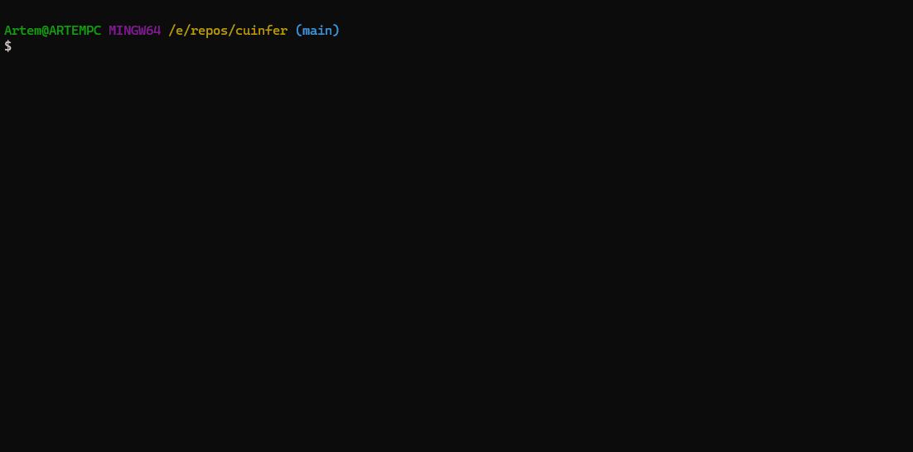

# CuInfer — LLM Inference Engine in C++17/CUDA

<p align="center">
  
</p>

CuInfer is a transformer inference engine written from scratch in C++17 and CUDA, with no dependency on PyTorch, cuBLAS, or any ML framework. It loads real pretrained models from GGUF files, runs a complete transformer forward pass through hand-written CUDA kernels, and generates autoregressive text on consumer hardware. The project covers the full stack: binary format parsing, BPE tokenization, quantized weight loading, attention with GQA and KV-cache, kernel fusion, and end-to-end generation — all implemented and verified against reference implementations.

**Hardware target**: NVIDIA RTX 3060 (6 GB VRAM, SM 8.6, Ampere, CUDA 12.8)
**Test coverage**: 221 tests passing, all kernels verified against CPU reference implementations

---

## What is implemented

### CUDA Kernels (36 total, written from scratch)

**Matrix multiplication**
- Naive kernel — one thread per output element, global memory only (reference baseline)
- Tiled kernel — 32x32 shared memory tiles; reduces global memory reads by ~32x vs naive
- Vectorized kernel — float4 loads for coalesced 128-bit transactions; 1.57–1.67x faster than tiled
- Transposed-B variant — used by the LM head
- Batched matmul with GQA broadcast — avoids physical K/V replication for grouped-query attention

**Quantized matmul (fused dequantize + accumulate)**
- Q8_0: 8-bit symmetric, 32-element blocks (34 bytes/block)
- Q4_0: 4-bit symmetric, packed nibbles, 32-element blocks (18 bytes/block)
- Q5_0: 5-bit, packed low nibbles + separate high-bit array (22 bytes/block)
- Q4_K: 4-bit K-quant, 256-element super-blocks with packed 6-bit sub-block scales (144 bytes/block)
- Q6_K: 6-bit K-quant, 256-element super-blocks with 16 interleaved sub-block scales (210 bytes/block)
- FP16: native `__half` weights with FP32 accumulation

All quantized kernels operate on GGUF-native [N, K] weight layout (B-transposed), dequantizing each tile into shared memory during accumulation rather than materializing a full FP32 weight matrix.

**Element-wise and reduction kernels**
- RMSNorm — shared memory tree reduction, one block per row
- RMSNorm (CUB) — `cub::BlockReduce` variant for comparison
- Softmax — three-pass numerically stable (max, sum-exp, normalize)
- Softmax (CUB) — `cub::BlockReduce` variant for comparison
- SiLU (Swish) — element-wise `x * sigmoid(x)`
- GeLU — tanh approximation
- RoPE — in-place pair rotation, configurable theta base (10k/100k)
- Add, Multiply — element-wise, used for residual connections

**Fused kernels**
- Fused RMSNorm + Residual Add — combines residual addition and normalization in one kernel; eliminates one global memory round-trip per layer
- Fused RMSNorm + Residual Add (CUB) — same with `cub::BlockReduce`
- Fused Decode Attention — single-kernel attention for seq_len=1 using online softmax (Milakov & Gimelshein 2018); replaces 9+ kernel launches per decode step

**Attention and supporting kernels**
- Causal mask — sets future positions to -inf
- Scale — multiplies scores by 1/sqrt(head_dim)
- Embedding lookup — parallel row gather
- Argmax — single-block parallel reduction with deterministic tie-breaking

### Model infrastructure

- **GGUF parser** — memory-mapped binary format parser (POSIX mmap + Win32 MapViewOfFile); supports metadata KV pairs and tensor info for all GGML types
- **BPE tokenizer** — SentencePiece-style (score-based merges, used by Llama/SmolLM2) and GPT2-style (explicit merge list); byte-fallback and GPT2 byte-level BPE; CPU-only
- **Tensor class** — RAII GPU allocation; 4D shape (`std::array<int64_t, 4>`); non-owning view variant for slicing; block-aware `size_bytes()` for quantized dtypes; explicit host/device transfers only
- **KV-cache** — pre-allocated contiguous GPU buffers for all layers; layout `[n_layers, max_seq_len, n_kv_heads, head_dim]`; GQA support (n_kv_heads < n_heads); separate K and V allocations; reset without reallocation
- **AttentionBlock** — QKV projection, RoPE, KV-cache update, scaled dot-product attention with causal mask, output projection; dispatches to fused decode attention for seq_len=1
- **GatedFFN** — SwiGLU (gate * up, then down) and standard GeLU FFN
- **TransformerModel** — loads GGUF, detects per-tensor weight format, dispatches to correct matmul kernel; forward pass and autoregressive generate loop with greedy argmax and top-k sampling
- **No dynamic allocation in the generation loop** — weights, KV-cache, and activation buffers are all pre-allocated

### Quantization format support matrix

| Format | Nominal bits | Effective bits/weight | Block size | Bytes/block | Used in Q4_K_M |
|--------|-------------|----------------------|------------|-------------|----------------|
| FP16   | 16          | 16.0                 | 1          | 2           | no             |
| Q8_0   | 8           | 8.5                  | 32         | 34          | yes (attn norm layers) |
| Q4_0   | 4           | 4.5                  | 32         | 18          | no             |
| Q5_0   | 5           | 5.5                  | 32         | 22          | yes (some layers) |
| Q4_K   | 4           | 4.5                  | 256        | 144         | yes (most layers) |
| Q6_K   | 6           | 6.6                  | 256        | 210         | yes (some layers) |

Q4_K_M is a mixed-format GGUF that uses different quantization formats per tensor. CuInfer detects the format of each tensor individually and dispatches to the appropriate kernel.

---

## Demo

The GIF above shows Llama 3.2 1B (Q4_K_M, 2.97 GB VRAM) generating text on an RTX 3060 Laptop GPU.

---

## Benchmark results

**Hardware**: NVIDIA RTX 3060 Laptop GPU, 6 GB GDDR6, 30 SMs, boost clock 1,777 MHz
**Methodology**: CUDA events timing, median of 100 runs after 10 warmup iterations
**Full results**: [docs/benchmarks.md](docs/benchmarks.md)

### End-to-end generation — SmolLM2-135M (135M parameters)

| Format | Tok/s (decode) | VRAM total | Weight size |
|--------|---------------|------------|-------------|
| FP16 (native `__half`) | 28.4 | 1.46 GB | 311 MB |
| Q8_0 | 27.8 | 1.35 GB | 216 MB |
| Q4_K_M (mixed) | 27.3 | 1.31 GB | 178 MB |
| PyTorch eager FP16 (reference) | 18.1 | 0.27 GB | 257 MB |

CuInfer FP16 is 1.6x faster than PyTorch eager on this model. PyTorch VRAM is lower because it uses cuBLAS and does not pre-allocate a KV-cache the same way.

### End-to-end generation — Llama 3.2 1B (1.24B parameters)

| Format | Tok/s (decode) | VRAM total | Weight size |
|--------|---------------|------------|-------------|
| Q8_0 | 6.8 | 3.42 GB | 1,988 MB |
| Q4_K_M (mixed) | 6.6 | 2.97 GB | 1,559 MB |

PyTorch FP16 eager achieves 28.3 tok/s on this model — 4.2x faster than CuInfer. At 1B parameters, the matmul performance gap between hand-written kernels and cuBLAS (5–7x measured) dominates total runtime. See [benchmarks](docs/benchmarks.md) for full analysis.

### Kernel-level results — matrix multiplication (FP32)

Measured at square matrix sizes (M=N=K). RTX 3060 theoretical FP32 peak: 12.74 TFLOPS.

| Size | Tiled (GFLOPS) | Vectorized (GFLOPS) | Vectorized % of peak |
|------|---------------|--------------------|----------------------|
| 512  | 728           | 1,181              | 9.3%                 |
| 1024 | 741           | 1,239              | 9.7%                 |
| 4096 | 726           | 1,139              | 8.9%                 |

The gap from peak reflects the gap between hand-written tiled kernels and production libraries (cuBLAS uses tensor cores and software pipelining). This gap is documented and expected for a from-scratch implementation.

### Kernel-level results — element-wise kernels

RTX 3060 theoretical memory bandwidth: 360 GB/s (192-bit bus, 15 Gbps GDDR6).

| Kernel | Effective BW (GB/s) | % of peak |
|--------|--------------------|-----------|
| Add | 311 | 86.4% |
| Multiply | 311 | 86.4% |
| SiLU | 307 | 85.3% |
| GeLU | 308 | 85.6% |
| RMSNorm | 228 | 63.3% |
| Softmax | 195 | 54.2% |

Element-wise kernels that do one read and one write reach near-peak bandwidth. Reduction kernels (RMSNorm, Softmax) are lower because they require multiple passes and inter-thread synchronization.

### Kernel fusion impact

| Operation | SmolLM2 (cols=768) | Llama 1B (cols=2048) | Speedup |
|-----------|-------------------|---------------------|---------|
| Separate add() + rmsnorm() | 31.7 µs | 79.9 µs | baseline |
| Fused RMSNorm + Residual | 25.6 µs | 62.5 µs | 1.24x / 1.28x |

### CUB vs hand-written reductions

`cub::BlockReduce` variants are 1.04–1.33x faster than the hand-written tree reduction across RMSNorm and Softmax. Both variants are shipped; the hand-written version documents the underlying algorithm.

---

## Logit verification

Logits from CuInfer's forward pass were compared against PyTorch (transformers library) on SmolLM2-135M:
- Maximum absolute difference: 0.000024
- All top-20 predicted tokens match exactly

---

## Supported models

| Model | Parameters | Formats verified | Min VRAM |
|-------|-----------|-----------------|----------|
| SmolLM2-135M | 135M | FP16, Q8_0, Q4_K_M | 1.31 GB |
| Llama 3.2 1B | 1.24B | Q8_0, Q4_K_M | 2.97 GB |

Any model in GGUF format using one of the supported quantization types and the Llama architecture (RMSNorm, SwiGLU FFN, GQA, RoPE) should load correctly. Other architectures (e.g., GPT-2 style GeLU FFN) are also supported via the standard FFN path.

---

## Architecture overview

Detailed design documentation: [docs/architecture.md](docs/architecture.md)

```
┌─────────────────────────────────────────────┐
│                  CLI / API                  │
├─────────────────────────────────────────────┤
│              Text Generation                │
│         (sampling: greedy, top-k)           │
├─────────────────────────────────────────────┤
│           TransformerModel                  │
│  ┌──────────┐ ┌──────────┐ ┌────────────┐   │
│  │  Embed   │ │ N×Block  │ │  LM Head   │   │
│  │          │ │┌────────┐│ │            │   │
│  │          │ ││ RMSNorm││ │            │   │
│  │          │ ││ MHA+KV ││ │            │   │
│  │          │ ││ RMSNorm││ │            │   │
│  │          │ ││ FFN    ││ │            │   │
│  │          │ │└────────┘│ │            │   │
│  └──────────┘ └──────────┘ └────────────┘   │
├─────────────────────────────────────────────┤
│             CUDA Kernel Layer               │
│  matmul │ softmax │ rmsnorm │ rope │ gelu   │
│  quantized_matmul │ fused_attention         │
├─────────────────────────────────────────────┤
│            Memory Management                │
│     GPU Allocator │ KV-Cache │ Tensors      │
├─────────────────────────────────────────────┤
│            Model I/O (GGUF)                 │
│     Weight Loading │ Tokenizer │ Config     │
└─────────────────────────────────────────────┘
```

---

## Build

### Requirements

- C++17 compiler: GCC 11+ or MSVC 2022
- CUDA Toolkit 12.x
- CMake 3.24+
- NVIDIA GPU, Compute Capability 7.5 or higher (SM 8.6 is the primary target)

No other dependencies are required at runtime. Google Test is fetched automatically by CMake for the test build.

### Build instructions

```bash
git clone https://github.com/Artemarius/CuInfer.git
cd CuInfer

# Configure — targets SM 8.6 by default (RTX 3060)
cmake -B build -DCMAKE_BUILD_TYPE=Release -DCMAKE_CUDA_ARCHITECTURES=86

# Build (all targets: library, CLI, tests, benchmarks)
cmake --build build --config Release -j$(nproc)
```

To target a different GPU, replace `86` with the appropriate compute capability (e.g., `75` for Turing, `80` for A100).

### Debug build

```bash
cmake -B build-debug -DCMAKE_BUILD_TYPE=Debug -DCMAKE_CUDA_ARCHITECTURES=86
cmake --build build-debug -j$(nproc)
```

---

## Usage

### Run inference

```bash
# Download a model (requires Python + huggingface_hub)
python scripts/download_model.py

# Run text generation
./build/cuinfer --model models/smollm2-135m-q8_0.gguf \
                --prompt "Once upon a time" \
                --max-tokens 200
```

### Run tests

```bash
cd build && ctest --output-on-failure
```

All 221 tests run without a model file — they use synthetic data. Tests include:

- Tensor class: allocation, views, host/device transfers, quantized size calculations
- Matmul kernels: naive, tiled, vectorized against CPU reference (`1e-5` tolerance)
- Elementwise kernels: RMSNorm, SiLU, GeLU, Softmax, RoPE, Add, Multiply
- Quantized matmul: Q8_0/Q4_0/Q5_0/Q4_K/Q6_K against dequant+FP32 reference (`5e-2` tolerance)
- Dequantize kernels: all 5 formats against GGML reference values
- GGUF parser: synthetic GGUF file construction and round-trip parsing
- Tokenizer: BPE encode/decode with byte-fallback
- KV-cache: append, prefill, GQA head layout, overflow detection
- Attention: MHA, GQA, causal mask, KV-cache integration
- FFN: gated SwiGLU, standard GeLU FFN, bias handling
- Embedding: lookup, LM head, argmax, top-k, tied weights
- Model: config parsing, weight transpose, forward pass data flow, sampling

### Run benchmarks

```bash
# Kernel-level matmul benchmark
./build/bench_matmul

# Elementwise and fused kernel benchmark
./build/bench_elementwise

# PyTorch kernel-level baseline (requires PyTorch)
python scripts/benchmark_pytorch.py

# PyTorch end-to-end baseline
python scripts/benchmark_pytorch_e2e.py

# Compare logits against PyTorch reference
python scripts/verify_logits.py
```

---

## Project structure

```
CuInfer/
├── CMakeLists.txt
├── include/cuinfer/
│   ├── cuda_utils.h              # Error checking macro, CUDA timer, VRAM reporting
│   ├── tensor.h                  # GPU tensor class (RAII, shape/stride, views, quantized dtypes)
│   ├── gguf_parser.h             # GGUF binary format parser (memory-mapped)
│   ├── tokenizer.h               # BPE tokenizer (SentencePiece + GPT2)
│   ├── kv_cache.h                # KV-cache for autoregressive generation
│   ├── attention.h               # Multi-head/GQA attention block + fused decode attention
│   ├── ffn.h                     # Feed-forward network (SwiGLU + standard GeLU)
│   ├── embedding.h               # Token embedding + LM head + sampling
│   ├── model.h                   # TransformerModel class
│   ├── quantization.h            # GGML block structs (Q8_0, Q4_0, Q5_0, Q4_K, Q6_K)
│   └── kernels/
│       ├── matmul.h              # FP32 matmul kernel declarations
│       ├── matmul_quant.h        # Quantized matmul kernel declarations
│       └── elementwise.h         # Activation, normalization, and RoPE kernel declarations
├── src/
│   ├── tensor.cu
│   ├── gguf_parser.cpp           # GGUF parser with mmap (POSIX + Win32)
│   ├── tokenizer.cpp             # BPE encode/decode with byte-fallback
│   ├── kv_cache.cu
│   ├── attention.cu
│   ├── ffn.cu
│   ├── embedding.cu
│   ├── model.cu                  # Weight loading, forward pass, generate loop
│   ├── kernels/
│   │   ├── matmul.cu             # Naive, tiled, vectorized matmul
│   │   ├── matmul_quant.cu       # Quantized matmul: Q8_0, Q4_0, Q5_0, Q4_K, Q6_K, FP16
│   │   ├── dequantize.cu         # Standalone GPU dequant kernels (5 formats)
│   │   └── elementwise.cu        # RMSNorm, SiLU, GeLU, Softmax, RoPE, Add, Mul, fused kernels
│   └── main.cu                   # CLI entry point
├── tests/
│   ├── test_tensor.cu
│   ├── test_matmul.cu
│   ├── test_elementwise.cu
│   ├── test_gguf_parser.cpp
│   ├── test_tokenizer.cpp
│   ├── test_kv_cache.cu
│   ├── test_attention.cu
│   ├── test_ffn.cu
│   ├── test_embedding.cu
│   ├── test_model.cu
│   ├── test_dequantize.cu
│   └── test_matmul_quant.cu
├── benchmarks/
│   ├── bench_matmul.cu
│   └── bench_elementwise.cu
├── scripts/
│   ├── benchmark_pytorch.py         # PyTorch kernel-level baseline
│   ├── benchmark_pytorch_e2e.py     # PyTorch end-to-end baseline (SmolLM2)
│   ├── benchmark_pytorch_llama1b.py # PyTorch end-to-end baseline (Llama 1B)
│   ├── reference_logits.py          # Generate reference logits from PyTorch
│   ├── verify_logits.py             # Compare CuInfer logits against PyTorch reference
│   └── download_model.py            # Download SmolLM2-135M GGUF from HuggingFace
├── docs/
│   ├── architecture.md              # System design, data flow, memory layout
│   ├── benchmarks.md                # Full benchmark report with methodology
│   ├── kernel_design.md             # Per-kernel algorithm and implementation details (36 kernels)
│   ├── gguf_format.md               # GGUF binary format and parser implementation
│   └── smollm2_gguf_mapping.md      # SmolLM2-135M GGUF tensor name reference
└── models/                       # Downloaded model files (gitignored)
```

---

## Technical documentation

- [docs/architecture.md](docs/architecture.md) — data flow through the transformer, memory layout decisions, KV-cache design, weight loading
- [docs/kernel_design.md](docs/kernel_design.md) — per-kernel algorithm documentation: tiled shared memory, dequantize-on-the-fly, online softmax, one-block-per-row reductions; 36 kernels across 6 categories
- [docs/benchmarks.md](docs/benchmarks.md) — full benchmark report: methodology, hardware specs, matmul throughput, elementwise bandwidth, end-to-end generation, CUB comparison, cuBLAS comparison, PyTorch baseline
- [docs/gguf_format.md](docs/gguf_format.md) — GGUF binary format: file layout, parser implementation, quantization block structures, weight name mapping
- [docs/smollm2_gguf_mapping.md](docs/smollm2_gguf_mapping.md) — GGUF tensor name to architecture mapping for SmolLM2-135M

---

## Design decisions

**No cuBLAS**: All matmul kernels are hand-written. cuBLAS (which uses tensor cores and software pipelining) would yield better numbers but obscure the implementation. The performance gap between the hand-written tiled kernel and cuBLAS is documented in `docs/benchmarks.md` as an explicit reference point.

**CUB for comparison**: Phase 3 introduced `cub::BlockReduce` variants for RMSNorm and Softmax alongside the hand-written versions. CUB ships with the CUDA toolkit and is header-only. Both variants are benchmarked; the hand-written versions remain the default path used in inference.

**GGUF format**: Weights are memory-mapped and uploaded to GPU as raw bytes in their quantized format. No host-side dequantization takes place. This keeps peak host RAM usage low and avoids a second copy of weight data.

**No Python runtime dependency**: The engine loads GGUF files and runs inference entirely in C++/CUDA. Model download and PyTorch comparison scripts require Python, but the inference binary does not.

**Memory allocation strategy**: Weights are loaded once at startup. The KV-cache is pre-allocated for the full maximum sequence length. Activation buffers are allocated once at the maximum batch size. The generation loop contains no `cudaMalloc` or `cudaFree` calls.

---

## License

MIT

---
